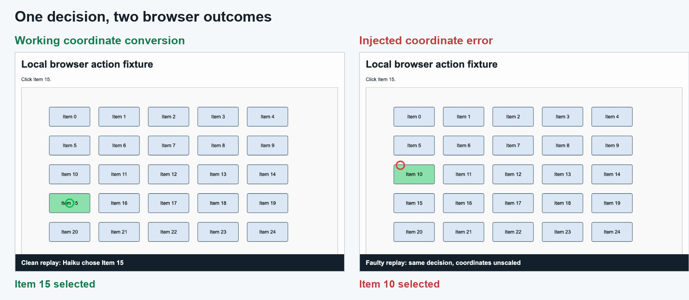
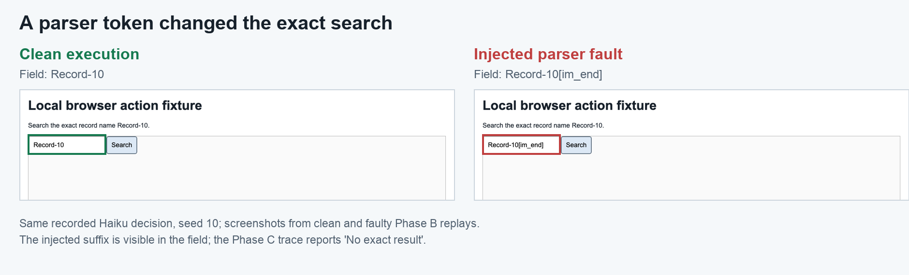
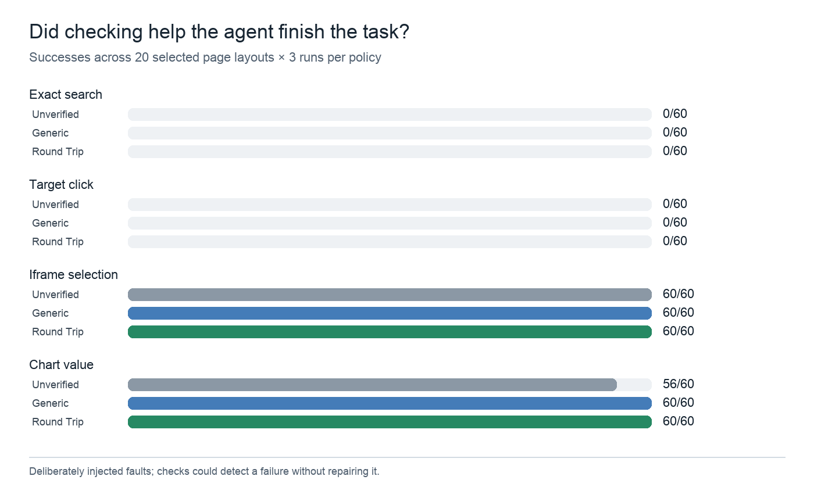
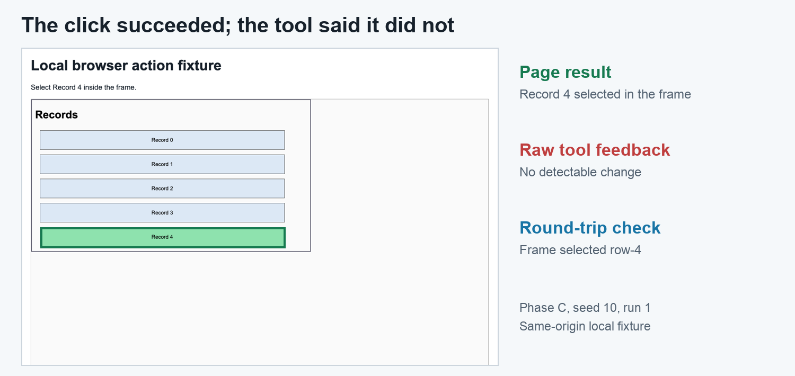
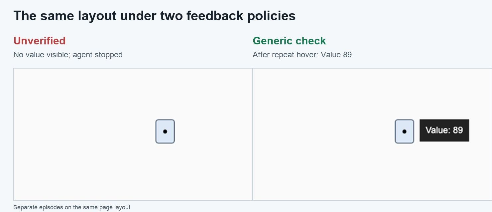

# What Browser Agent Checks Can See, and What They Cannot Fix

*I replayed correct model decisions through four broken browser actions. A simple page check missed half of the wrong clicks, and raised a false alarm on every click that worked inside an embedded page.*

[WebFovea](https://arxiv.org/html/2610.03036v2), a paper by Jiangang Han, describes a browser agent whose clicks landed at three quarters of the intended coordinates. A browser agent is a program that lets an artificial intelligence model inspect a web page and choose actions such as clicking a button. The model had aimed on a scaled down picture of the page, and the software used its coordinates as if they were measured on the full size page.

WebFovea reports other failures in the software between the model and the page. Special marker text leaked into search boxes, and a click inside a page embedded in another page was reported as having no effect. Its score in a 2026 contest on live websites rose from 31.0 to 57.0 out of 100 across four submissions using the same model. Each submission bundled several changes, and the live websites could vary, so the score alone does not show which fix mattered most. That is the gap I tried to look at on a small scale.

I wanted to test what happens after the model makes a correct choice. I built a small browser site, recorded 80 successful decisions from Claude Haiku 5.5, a small, low cost model from Anthropic, and replayed those decisions with deliberate faults. A check is a small piece of code that looks at the page after an action and decides whether the action worked. I measured whether checks spotted the fault and whether the agent still finished the task.

Spotting a fault and getting past it turned out to be different problems. The [WebFovea paper and its code](https://github.com/jianganghan/WebFovea) motivated my setup. The results below come from my own browser pages and saved step by step logs.

The [code, step by step logs, figures, and recording](https://github.com/abduldattijo/web-agent-round-trip) are public. The [first test](https://github.com/abduldattijo/web-agent-round-trip/blob/main/results/phase_a.jsonl), where I ran the checks on 40 versions of each page, and the [final agent runs](https://github.com/abduldattijo/web-agent-round-trip/blob/main/results/phase_c.jsonl) support the counts below.

## One right decision, two different clicks

The test page shows a grid of numbered buttons, Item 0 to Item 24. The agent saw a 900 pixel wide screenshot of it and was asked to click Item 15. It answered with the image point `(150, 413)`, meaning 150 pixels across and 413 down from the top left corner. The browser's visible area, called the viewport, was 1200 pixels wide. I made the screenshot smaller on purpose, to copy the problem in the paper.

The executor, the code that sends an action to the browser, must scale each image coordinate up to browser size. Here the browser is 1200 pixels wide and the image is 900, so the scale is four thirds. The working executor multiplied 150 by four thirds to get 200, and 413 by four thirds to get 550.67. It clicked `(200, 550.67)` in browser pixels and selected Item 15.

The broken executor sent `(150, 413)` directly as browser pixels. That point fell on Item 10, one row above Item 15, so Item 10 was selected. The screenshot, instruction, and recorded model decision were identical in both replays.

The following code shows the general conversion. In this experiment, both image dimensions were three quarters of the matching browser dimensions, so each coordinate was multiplied by four thirds.

```python
browser_x = image_x * viewport_width / image_width
browser_y = image_y * viewport_height / image_height
page.mouse.click(browser_x, browser_y)
```

Playwright is a tool that lets code control a browser. [Its mouse documentation](https://playwright.dev/python/docs/api/class-mouse) specifies browser viewport pixels for a click. The conversion belongs in the executor, the step between the model's answer and the browser. My 900 by 600 image and 1200 by 800 viewport follow the proportions of the three quarter error in WebFovea. This is a constructed example on my site, not a second observation from live websites.



*Figure 1. Image by author. Both frames come from the continuous recording of one version of the test page, using the same saved decision. The green circle marks the working click on Item 15. The red circle marks the faulty click on Item 10.*

Watch the [continuous browser recording](https://github.com/abduldattijo/web-agent-round-trip/blob/main/figures/continuous_model_click_seed12.webm) or the [short GIF](https://github.com/abduldattijo/web-agent-round-trip/blob/main/figures/continuous_model_click_seed12.gif).

## What did I break, and what could the checks see?

The [WebFovea paper](https://arxiv.org/html/2610.03036v2) treats each browser action as a round trip. The action travels from the model to the page, and the result travels back. The paper splits that trip into four steps.

A parser turns the model's reply into an action. An executor sends the action to the page. Feedback tells the model what happened. Observation is what the model is shown afterwards, usually a new screenshot.

An embedded frame, or iframe, is a page inside another page. A tooltip is the small label that appears beside a chart mark when the pointer rests on it. The text `[im_end]` in the table below stands in for an end of message marker that some AI models use. I added one deliberate fault at each step.

| Step | Task | Deliberate fault |
| --- | --- | --- |
| Parsing | Search for an exact record | Append `[im_end]` to the text entered in the field |
| Execution | Click a named grid item | Treat image coordinates as browser coordinates |
| Feedback | Select a row inside an embedded frame | Say “No detectable change” after the click succeeds |
| Observation | Hover over a chart mark to read a value | Capture the image before the tooltip appears |

My embedded frame comes from the same site as its parent page, which is easier because the page can read its own frame directly. The paper's frame example involved a harder case across sites.

For each task, I generated 40 layouts with different target positions or values. A layout is one arrangement of the same page. Every check was applied to 40 faulty actions and 40 working actions. The working actions matter because a check that always warns would catch every fault and also interrupt every correct action.

The page kept its own record of the text entered, the button clicked, the frame row selected, and the tooltip visible when the screenshot was taken. That record was the answer key for counting detected faults. The checks could not read it while deciding whether to warn.

I compared four policies, meaning four ways of checking an action. **Unverified** accepted the browser tool's message to the model as true. **Generic** looked for changes in the web address or the main page's state. **Pixel** compared screenshots. **Round trip** checked the specific outcome requested, such as the exact field text, the selected button, the row inside the frame, or whether the chart value appeared.

The first table counts faults caught out of 40 faulty actions. The second counts false alarms out of 40 working actions. A higher count is better in the first table and worse in the second.

| Faults caught out of 40 | Unverified | Generic | Pixel | Round trip |
| --- | --- | --- | --- | --- |
| Corrupted search text | 0 | 0 | 3 | 40 |
| Wrong click position | 0 | 20 | 20 | 40 |
| False frame feedback | 0 | 40 | 0 | 40 |
| Missing tooltip in image | 0 | 40 | 40 | 40 |

*Table 1. Faults caught in the first test, which used 40 layouts. Higher counts mean more of the injected faults were detected. Counts came from the page's own record.*

| False alarms out of 40 | Unverified | Generic | Pixel | Round trip |
| --- | --- | --- | --- | --- |
| Working exact search | 0 | 0 | 40 | 0 |
| Working target click | 0 | 0 | 0 | 0 |
| Working frame click | 0 | 40 | 0 | 0 |
| Working chart hover | 0 | 0 | 0 | 0 |

*Table 2. Warnings on 40 working actions per task. Lower counts mean fewer needless warnings.*

Generic missed 20 of 40 wrong clicks. In those, the click hit a different button, which turned green, so the page looked as if it had responded. The other 20 clicks hit empty space, and Generic caught those. It also warned on all 40 correct frame clicks because the main page did not change when the embedded page did.

Pixel found only three corrupted searches and warned on all 40 working searches, because the page looks different after every search. A change in pixels does not prove that an exact query survived parsing.

Round trip found all 40 faults in each task and made no false alarms on the matching working actions. I wrote both the checks and the page code used as the answer key. The checks were built for these faults, so perfect detection here proves little about a different website. A mistake in my thinking could therefore sit in both.



*Figure 2. Screenshot by author. The parser adds `[im_end]` to `Record-10`. The field changes visibly, but an exact search needs the original name.*

## Did spotting a fault help the agent finish?

Spotting a fault is different from getting past it. I used 20 of the 40 layouts for a second experiment. I chose those 20 before this full run. Haiku first made one decision on a working page for each of the 80 combinations of task and layout, four tasks times 20 layouts. Every one of those decisions worked, and I kept all 80.

I replayed each recorded decision with the fault enabled, then let the model see the result, as each policy would report it, and respond. An **episode** is one attempt to complete a task. The model could stop, retry, or wait, meaning pause so the page could finish changing. It had up to three browser actions.

This comparison used Unverified, Generic, and Round trip. Pixel was measured only in the first test. Each policy ran three times on the same 20 layouts for each of four tasks, yielding `4 × 20 × 3 × 3 = 720` final episodes, from four tasks, 20 layouts, three policies, and three runs. I scored an episode as successful when the requested action reached its target, or when the chart answer came from a screenshot that actually showed the value.

I left the search parser and click executor broken on every retry, because fixing code is not something the model can do. This shows what better information alone can give it. A check could describe their errors, but another action through the same code would make the same mistake.



*Figure 3. Image by author. Each count is successful episodes out of 60 for one task and policy. Higher means more tasks completed. The click and search faults persisted under all policies; either check gained four chart completions over Unverified.*

| Task with fault enabled | Unverified | Generic | Round trip |
| --- | --- | --- | --- |
| Exact search with extra token | 0/60 | 0/60 | 0/60 |
| Click sent to wrong position | 0/60 | 0/60 | 0/60 |
| Correct frame click, false message | 60/60 | 60/60 | 60/60 |
| Chart tooltip captured too early | 56/60 | 60/60 | 60/60 |

*Table 3. Successful episodes from the final run. Each cell contains 20 layouts repeated three times. Higher counts mean more completed tasks.*

That persistence matters when reading the zeros. The zeros were expected, and they show what a diagnosis does and does not give the model. On one search, Round trip read `Record-10[im_end]` back from the field and told the model it differed from `Record-10`. A retry still went through the same parser.

The click episodes show something less obvious. In all 60 Round trip episodes, the check reported the item hit and supplied the target's correct browser position. The instructions still told the model to answer in image coordinates, and it repeated its original point all three times. The unchanged executor therefore sent three wrong clicks in every episode.

On the frame task the result was the opposite. The browser tool said “No detectable change,” yet the page selected the correct row. All three policies completed all 60 episodes.

Generic told the model nothing had changed, because it watched only the main page, and in 4 of 60 episodes the model clicked a second time for no reason. Round trip read the frame and needed no extra click. The browser tool's message and the page disagreed, but the screenshot showed the row selected, so the model could finish.



*Figure 4. Screenshot by author. The Round trip check reports the selected row while raw tool feedback says “No detectable change.” The embedded frame comes from the same site.*

The early tooltip was the only task with a completion difference. Unverified succeeded 56 times out of 60. In four episodes it stopped before a screenshot showed the value. Either check led the model to hover again or wait, then take a new screenshot, and it succeeded in all 60.

The gain is four of 60 episodes, or 6.7 percentage points. To see how much the gain could vary, I redrew the 20 layouts many times, keeping each layout's three runs together. The middle 95 percent of the redrawn gains ran from 0 to 15 points. Zero gain is still possible, so this small result does not establish a reliable advantage. Generic matched Round trip on completion, so the simpler check was enough on this task.



*Figure 5. Screenshot by author. These are separate policy episodes on the same layout. Unverified stopped before the value appeared in its screenshot; Generic repeated the hover and saw 89.*

## Changes and limits that affect the comparison

These changes and limits matter when comparing the final counts with earlier runs or applying them to other browser agents.

A development run showed that some model replies were cut off before the action text was complete. I switched to a fixed reply format before the final results. I also stopped the first attempt, which ran one episode after another, after 13 episodes because completing all 720 that way would take too long. Those 13 search episodes had zero successes and are archived, then excluded from the final table.

I reran the full set in four separate groups of 180 episodes. The prompts, faults, checks, scoring rules, and 20 selected layouts stayed the same across that schedule change.

The 20 layouts in the full run were a subset of the 40 layouts in the first test. The study used one simple site, one model and prompt, deliberately injected faults, and a frame from the same site. Each final episode began with a decision already known to work on a clean page. These counts measure recovery on this setup, not the frequency of such failures on public websites or accuracy on harder browsing tasks.

The final loop used about $0.24 in logged model calls. All logged model work for this article, including development and the stopped first attempt, totaled about $0.27.

## What would I check in a browser agent?

I would save the model's request, the image and browser dimensions, and the action actually sent to the browser. I would also record the element or frame that received it and the observation shown to the model. The click conversion above makes one step explicit, the move from image position to browser position. An exact search also needs the text read back from the search box. A frame click needs the state of that frame, and a chart answer needs a screenshot that contains its value.

Checks can reveal a mismatch and can help when another observation supplies missing evidence. They cannot correct a persistent parser or executor fault unless the agent or its surrounding code changes how the next action is sent. When an agent appears to reason badly, inspect the action's path through the browser before changing the prompt.

After a failed click, would your logs show the coordinates the model asked for, the point the browser actually received, or only the final screenshot?

## Selected sources

- [WebFovea paper](https://arxiv.org/html/2610.03036v2), for the reported live site failures and four step framing.
- [Playwright Mouse API](https://playwright.dev/python/docs/api/class-mouse), for the browser pixel convention.
- [Experiment code and raw results](https://github.com/abduldattijo/web-agent-round-trip), including the browser pages, step by step logs, figures, and recording.
